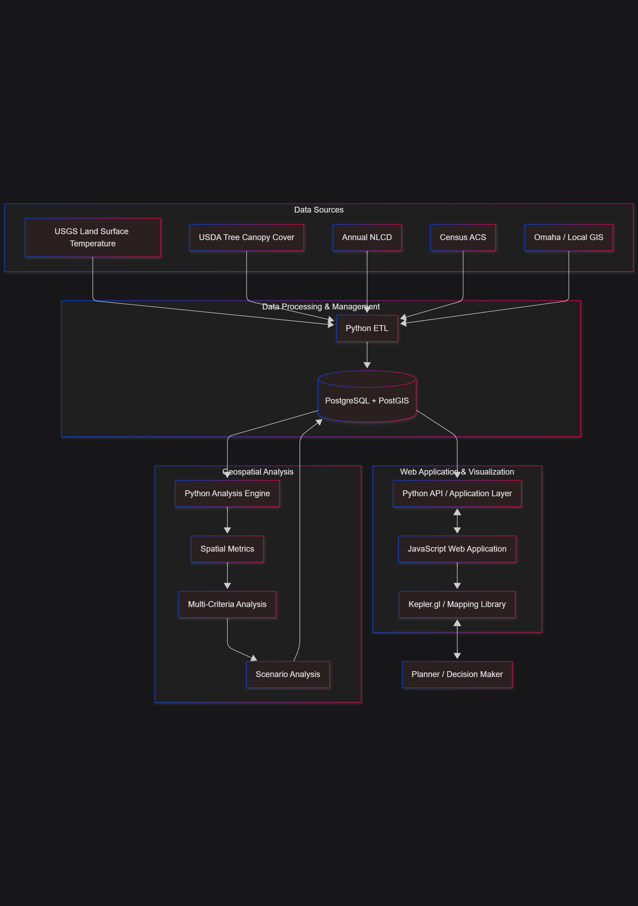
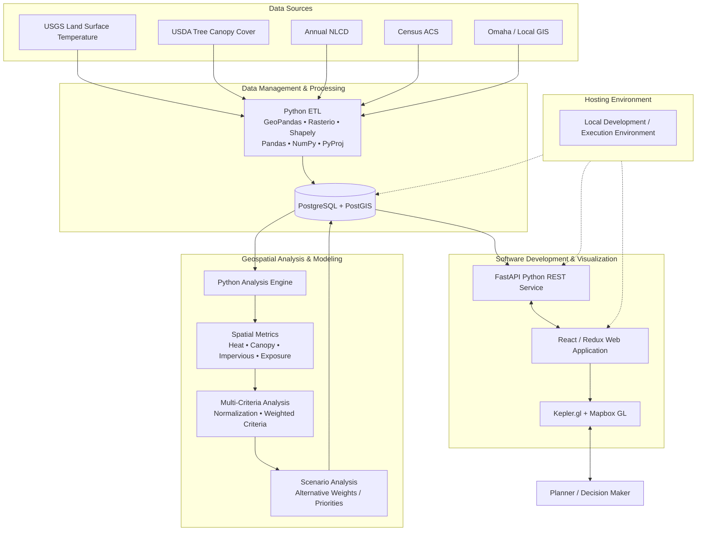

# Executive Summary: Omaha Urban Heat Mitigation Decision-Support Toolkit

**Prepared by:** David Vanosdall  
**Course:** GEOG 778, Fall 2026  
**Repository:** https://github.com/dvanosdall/GEOG_778  

---

## 1. Introduction & Background

### 1.1 Problem Context
Extreme urban heat is a critical place-based public health and infrastructure challenge in Omaha, Nebraska (Douglas County). Across the metropolitan area, Land Surface Temperature (LST), tree canopy coverage, impervious surface density (asphalt, concrete, rooftops), and demographic vulnerability vary substantially from neighborhood to neighborhood. While municipal planners and researchers have access to rich public environmental and census datasets, these datasets in isolation rarely translate into actionable investment decisions. A standalone heat map shows *where* temperatures are high, and a canopy map shows *where* trees are sparse, but neither tells a planner *why* an area should be prioritized over another, *which* physical intervention is most appropriate, or *how* priorities shift under competing policy objectives.

### 1.2 Project Intention, Geographic Extent, and Intended Audience
The **Omaha Urban Heat Mitigation Decision-Support Toolkit** addresses this gap by integrating environmental, land cover, and demographic data into an interactive, web-based Multi-Criteria Decision Analysis (MCDA) application covering **Douglas County / Omaha, Nebraska** (evaluated at the U.S. Census Block Group level across 489 block groups). Rather than producing a single static priority map, the toolkit functions as an exploratory decision-support system built to answer three core planning questions:
1. **Why is a neighborhood a priority?** (Which underlying environmental or demographic factors drive its score?)
2. **What type of mitigation intervention is most appropriate?** (e.g., urban forestry, cool roofs, community shade structures, or pervious paving)
3. **How do geographic priorities and affected populations change** when different planning criteria are emphasized?

**Intended Audience:**
* **Municipal & Urban Planners** allocating capital improvement and climate-resilience budgets.
* **Urban Forestry Staff** identifying high-impact neighborhoods for tree canopy expansion.
* **Sustainability & Public Health Coordinators** targeting cooling centers and shade infrastructure toward heat-vulnerable residents.
* **GIS Professionals & Researchers** supporting municipal heat-mitigation workflows and scenario modeling.

---

## 2. Methods: Analytical & Technological Approach

The toolkit's design and implementation draw directly on five core Knowledge Areas of the **UCGIS Geographic Information Science & Technology Body of Knowledge (GIS&T BoK)**: **Analytics and Modeling (AM)**, **Data Management (DM)**, **Cartography and Visualization (CV)**, **Programming and Development (PD)**, and **Domain Applications (DA)**.

### 2.1 Multi-Source Geospatial Data Integration (DM, DA)
Five authoritative public datasets are standardized to **WGS 84 (`EPSG:4326`)** and aggregated to Census Block Group polygons:

| Dataset | Source | Analytical Role |
| :--- | :--- | :--- |
| **Land Surface Temperature (LST)** | USGS Landsat 9 Collection 2 Level-2 (July 17, 2026) | Measures peak-summer thermal stress (°C) via thermal infrared Band 10. |
| **Tree Canopy Cover (TCC)** | USDA Forest Service (GTAC) | Quantifies existing shade percentage to derive **Tree Canopy Deficit**. |
| **Developed Imperviousness** | MRLC National Land Cover Database (NLCD) | Captures concrete, asphalt, and rooftop density (%) driving heat retention. |
| **Demographic Vulnerability** | IPUMS NHGIS / U.S. Census ACS | Provides total population and heat-sensitive age cohorts (**Under 5** and **65+**). |
| **Local Geographic Context** | Douglas Omaha GIS (DOGIS) | Provides municipal boundaries, streets, parks, and schools for spatial context. |

### 2.2 Spatial ETL & Database Architecture (DM, PD)
An automated Python ETL pipeline (`Scripts/urban_heat_etl_analysis.py`, built with **GeoPandas**, **Rasterio**, **Shapely**, **PyProj**, and **SQLAlchemy/GeoAlchemy2**) reprojects raw vector/raster inputs, performs zonal statistics across block group boundaries, and loads structured tables into **PostgreSQL with PostGIS** (`Database/schema.sql`) indexed with `GIST` spatial indexes for low-latency GeoJSON retrieval.

### 2.3 Multi-Criteria Decision Analysis & Heuristic Modeling (AM)
To compare heterogeneous physical and social metrics on a common scale, each criterion is linearly normalized to a **0.0–100.0** index across the study area:
* **Direct criteria** (higher value = higher priority): Land Surface Temperature, Impervious Surfaces, and Social Vulnerability, where Social Vulnerability is defined as:

  $$\text{Vulnerability Index} = \frac{\text{Population Under 5} + \text{Population 65+}}{\text{Total Population}} \times 100$$

* **Inverted criterion** (lower value = higher priority): Tree Canopy Cover is inverted so that neighborhoods with the lowest existing canopy receive the highest **Canopy Deficit** score.

User-configured slider weights ($0\text{–}10$) are proportionally rescaled to sum to $1.0$ ($100\%$) and combined via **Weighted Linear Combination (WLC)**:

$$\text{Priority Score} = (T_{\text{norm}} \times W_{\text{temp}}) + (C_{\text{norm}} \times W_{\text{canopy}}) + (I_{\text{norm}} \times W_{\text{imperv}}) + (V_{\text{norm}} \times W_{\text{vulner}})$$

Finally, a deterministic **rule-based heuristic** classifies each block group's dominant risk profile into one of five actionable strategies:
* *Urban Forestry & Tree Canopy Expansion* (`Temp >= 60` and `Canopy Deficit >= 65`)
* *Cool Roof & Cool Surface Retrofitting* (`Temp >= 60` and `Impervious >= 70`)
* *Community Shade Structures & Parks* (`Temp >= 50` and `Vulnerability >= 60`)
* *Pervious Paving & Rain Gardens* (`Impervious >= 50`)
* *General Cool Infrastructure* (baseline fallback)

### 2.4 Cartographic & Application Design (CV, PD)
The interactive dashboard is built with **React**, **Redux**, **Kepler.gl (v2.5.5)**, and **Mapbox GL** (`Frontend/js/app.js`), backed by a **FastAPI** REST service (`Backend/app.py`). Key cartographic and engineering choices include:
* **Colorblind-Safe Choropleth Design**: To ensure accessibility for users with protanopia, deuteranopia, and tritanopia, the map uses a 6-class **Light-to-Dark Purple** sequential luminance ramp (`#f3e8ff` → `#4c1d95`) with white polygon borders (`#ffffff`) over a dark basemap, paired with a quantile legend.
* **Resilient Dual-Mode Execution**: On startup, the frontend probes the FastAPI backend (`http://127.0.0.1:8000/`). When online, it queries live PostgreSQL/PostGIS data; when offline, it seamlessly falls back to an in-browser MCDA engine (`mcda_engine.js`) and simulated Omaha grid (`data_generator.js`) so demonstrations and testing never fail due to server downtime.

---

## 3. Architectural & Software Diagram

The system follows a decoupled four-tier architecture connecting raw spatial data ingestion, PostGIS storage, Python REST analytics, and client-side WebGL visualization:

---

## 4. Results: Implemented Features & Use Case Scenarios

### 4.1 Core Application Features
* **1. Planning Criteria Weights**: Four interactive sliders (`0–10`) for *Land Surface Temperature*, *Tree Canopy Deficit*, *Impervious Surfaces*, and *Social Vulnerability*, with an **Apply weights & Recalculate** trigger.
* **2. Scenario Statistics**: Two live KPI cards that dynamically update from the active dataset (live PostGIS when connected, or mockup fallback):
  * **Avg Priority Score (`X.X / 100`)**: Study-area-wide mean priority index.
  * **High Priority Pop (`XX,XXX`)**: Total residents living in focus zones scoring `>= 60.0 / 100`.
* **3. Focus Area Inspection & Transparency**: Hovering over any block group highlights its boundary in yellow and updates the sidebar live; clicking locks the selection. The inspector displays FIPS code, raw LST (°C), Canopy Cover (%), Imperviousness (%), Total Population, **Vulnerable (<5 / 65+)** breakdown and index %, Final Priority Score, and the tailored **Recommended Interventions** callout. An **About Toolkit** modal documents the exact formulas, thresholds, and data citations directly inside the app.
* **Scenario Export**: One-click **Export Scenario GeoJSON** downloads the active weighted results for downstream use in QGIS or ArcGIS Pro.

### 4.2 Example Use Case Scenarios

1. **Scenario A — "Extreme Urban Heat Islands First" (Physical Heat & Built Environment)**
   * *Weights*: Temperature = `10`, Impervious Surfaces = `8`, Canopy Deficit = `1`, Social Vulnerability = `1`.
   * *Outcome*: Deep purple priority clusters concentrate in Omaha's dense urban core, commercial corridors, and industrial zones where asphalt and rooftops trap thermal energy. Recommended interventions predominantly flag **Cool Roof & Cool Surface Retrofitting** and **Pervious Paving & Rain Gardens**, guiding public works toward high-albedo surface upgrades.
2. **Scenario B — "Urban Forestry & Green Equity" (Canopy Expansion)**
   * *Weights*: Tree Canopy Deficit = `10`, others = `1`.
   * *Outcome*: Highlights neighborhoods lacking natural shade rather than solely peak asphalt heat. Recommended interventions shift heavily toward **Urban Forestry & Tree Canopy Expansion**, giving city arborists a transparent, data-backed planting priority list.
3. **Scenario C — "Socio-Environmental Vulnerability" (Public Health & Cooling Equity)**
   * *Weights*: Social Vulnerability = `10`, others = `1`.
   * *Outcome*: Shifts focus toward densely populated residential block groups with high concentrations of children under 5 and seniors 65+. Notably, **High Priority Pop** rises substantially compared to Scenario A, demonstrating to decision-makers how weighting demographic exposure reaches more vulnerable residents per dollar invested and surfaces **Community Shade Structures & Parks** as top interventions.

---

## 5. Conclusion

### 5.1 Summary of Contributions
This project delivers an end-to-end, reproducible spatial decision-support toolkit for Omaha—combining automated Python raster/vector ETL, a PostGIS spatial database, a FastAPI analytical backend, and an accessible React/Kepler.gl web dashboard. It moves beyond static mapping by making the *why* behind every priority score transparent and interactive.

### 5.2 Key Lessons Learned
* **State Synchronization in Web Mapping**: Integrating Kepler.gl via UMD/Redux revealed ingestion race conditions where programmatic layer configs were validated before incoming GeoJSON fields registered in the store. Decoupling dataset ingestion from visual channel binding (`layerVisualChannelConfigChange`) resolved this reliably.
* **Cartographic Accessibility**: Standard red-yellow-green heat palettes create barriers for colorblind users and can clash on dark basemaps; transitioning to a single-hue **Light-to-Dark Purple** luminance ramp improved both legibility and accessibility.
* **Graceful Fallback Architecture**: Supporting both live PostGIS/FastAPI execution and an offline browser engine proved essential for reliable testing and stakeholder demonstrations across restricted network environments.

### 5.3 Limitations
* **Spatial Aggregation (MAUP)**: Aggregating 30m Landsat/NLCD rasters to Census Block Groups can mask micro-scale hotspots (e.g., a single unshaded transit stop or parking lot) inside an otherwise moderate block group.
* **Linear Min-Max Normalization**: Normalization scales relative to the study area's observed min/max values, meaning extreme outliers can compress the middle range of scores.
* **Single-Date Thermal Snapshot**: Relying on one peak-summer Landsat scene captures daytime surface heat rather than multi-year trends or nighttime air temperature disparities.
* **Site Feasibility**: Heuristic recommendations identify *need*, not parcel-level engineering constraints (e.g., underground utilities, soil suitability, or private vs. public land ownership).

### 5.4 Directions for Future Work
* **Side-by-Side Scenario Comparison**: Add a split-map or delta-score view to quantify exact rank changes between two saved scenarios.
* **Parcel & Right-of-Way Screening**: Incorporate DOGIS parcel ownership and street right-of-way layers to filter planting/shade recommendations to actionable public land.
* **Multi-Temporal & Nighttime Heat**: Integrate multi-summer Landsat composites and mobile air-temperature traverses to capture nocturnal urban heat island persistence.
* **Cloud Deployment**: Containerize the FastAPI + PostGIS stack (e.g., Docker) for shared municipal hosting beyond local execution.
